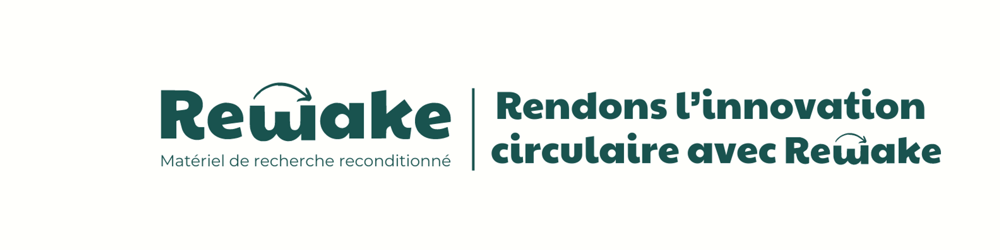

# Rewake Branding

Les ressources de design et guidelines pour l'identité visuelle de **Rewake**.

---

## 📁 Structure

```
Branding/
├── logos/          # Logo complet « Rewake » (SVG + PNG)
├── icons/          # Logo carré / monogramme (SVG + PNG)
├── favicons/       # Favicon (SVG, PNG, ICO)
├── banners/        # Bannières
└── guidelines.md   # Règles d'utilisation
```

---

## 🎨 Éléments

| Élément | Aperçu | Fichiers | Utilisation |
|---------|--------|----------|-------------|
| Logo vert, sans fond |  | [`SVG`](./logos/rewake_vert_sans_fond.svg) · [`PNG`](./logos/rewake_vert_sans_fond.png) | Logo principal, fonds clairs |
| Logo vert, fond blanc |  | [`SVG`](./logos/rewake_vert_fond_blanc.svg) · [`PNG`](./logos/rewake_vert_fond_blanc.png) | Documents, supports imprimés |
| Logo blanc, sans fond |  | [`SVG`](./logos/rewake_blanc_sans_fond.svg) · [`PNG`](./logos/rewake_blanc_sans_fond.png) | Fonds sombres / footer *(invisible sur fond clair)* |
| Carré vert, sans fond |  | [`SVG`](./icons/carre_vert_sans_fond.svg) · [`PNG`](./icons/carre_vert_sans_fond.png) | Monogramme, avatars, petits formats |
| Carré vert, fond blanc |  | [`SVG`](./icons/carre_vert_fond_blanc.svg) · [`PNG`](./icons/carre_vert_fond_blanc.png) | Photo de profil réseaux sociaux |
| Carré blanc, sans fond |  | [`SVG`](./icons/carre_blanc_sans_fond.svg) · [`PNG`](./icons/carre_blanc_sans_fond.png) | Monogramme sur fond sombre *(invisible sur fond clair)* |
| Favicon |  | [`SVG`](./favicons/favicon.svg) · [`PNG`](./favicons/favicon.png) · [`ICO`](./favicons/favicon.ico) | Onglet navigateur, icône d'app |
| Bannière |  | [`PNG`](./banners/banniere_rewake.png) | En-tête LinkedIn, e-mails, présentations |

---

## 📖 Guidelines

Voir [guidelines.md](./guidelines.md) pour les règles détaillées :
- Utilisation du logo (tailles, espacement, variantes)
- Hiérarchie typographique
- Combinaisons de couleurs autorisées
- Exemples d'application

---

## 🛠 Utilisation

**Utiliser en CSS/JSX**
   ```jsx
   <h1 className="text-primary font-sans">Rewake</h1>
   ```

**Exemple de thème complet**  
   Voir [guidelines.md](./guidelines.md) pour les variables CSS complètes.

---

## 🔗 Ressources Externes

- [Tailwind Color Docs](https://tailwindcss.com/docs/colors)
- [Geist Font](https://vercel.com/font)
